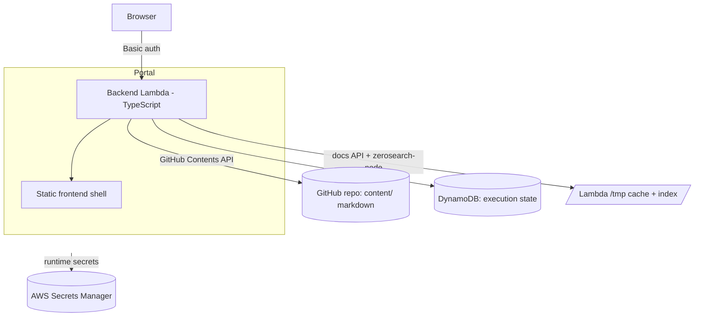

# DataOps

DataOps is the combined DataTalks.Club operations portal.

Version 1 focuses on operations docs and tasks:

- process docs, SOPs, templates, references, playbooks, prompts, and search
- task workflows, cards, recurring work, required links, and execution state
- AWS Lambda deployment with GitHub Actions OIDC

The deployed V1 app is the DataTalks.Club operations portal for
`ops.dtcdev.click`, served from the `DataTalksClub/dataops` repository and the
`dataops-v1` stack. The single backend lives under `backend/` and serves the
frontend, docs, search, and work APIs from one TypeScript Lambda.

DataOps has no built-in assistant. Assistants run outside the portal and work
through its API: they read and update cards, tasks, templates, newsletter
issues and podcast episodes, read the calendar built from them, and attach
their outputs as artifacts.

## Layout

- `content/` — operational documentation (SOPs, templates, references,
  playbooks, prompts) and its image assets.
- `backend/` — single TypeScript backend: docs content API, search, work
  execution, and portal/auth.
- `docs/` — repo-meta docs (this README, `STRUCTURE.md`, `sop-format*.md`,
  archived materials).
- `docs/` — DataOps merge plan, development process, and planning notes.
- `frontend/` — static vanilla-JS app and its Dockerfile.
- `infra/` — SAM/CloudFormation templates, OIDC deploy roles, runtime secrets.
- `tools/content_tools/` — pure-Python content validation CLIs (docs link
  validation, knowledge-repo validation, process-quality reports).
- `scripts/` — repo tooling (planning-docs validator).

## Architecture

DataOps is a portal served by a single TypeScript backend Lambda. GitHub is the
source of truth for all markdown content; execution state lives in DynamoDB.

| Component | Path | Runtime | Responsibility |
|---|---|---|---|
| Frontend shell | `frontend/` | Static vanilla JS | SOP block editor, search UI, filters, publish dialog. No build step; served as static assets. |
| Backend | `backend/` | TypeScript / Node (Lambda) | Single backend: serves the frontend, docs content API, `zerosearch-node` search, work execution, and GitHub-backed content editing from one Function URL. |



How the pieces fit:

- **Content is GitHub-backed.** Edits made in the UI are committed straight to
  GitHub by the backend through the Contents API; the Lambda keeps a `/tmp`
  cache and builds a `zerosearch-node` index from it. No SQLite, no EFS.
- **One backend serves everything.** The frontend, docs API, search, and work
  APIs run in a single TypeScript Lambda with a single Function URL. The old
  three-process split (frontend proxy + Python docs Lambda + work engine) is
  gone. Local dev is `make dev` (one origin on port 3000).
- **Assistants are external API clients.** The portal does not run an
  assistant; an external assistant uses the same cards, tasks, and artifacts
  APIs as the UI.
- **Infra is SAM/CloudFormation** (templates under `infra/`),
  deployed by GitHub Actions through an AWS OIDC role; runtime secrets live in
  AWS Secrets Manager rather than GitHub Actions secrets.

See `docs/TARGET_ARCHITECTURE.md` for the target layout and design rationale.

## Planning

- [Portal Analysis](PORTAL_ANALYSIS.md)
- [Shared Project Plan](PROJECT_PLAN.md)
- [Merge Plan](docs/MERGE_PLAN.md)

## Running locally

Local dev is a single backend that serves the frontend + docs + work APIs from
one origin (port 3000):

```bash
make setup
make dev
```

For a workstation-local GitHub content cache, put `DTC_CACHE_ROOT` in the
ignored root `.env`; `npm run dev` reads that setting automatically. Explicit
shell values still take precedence.

## Development commands

`make help` lists the current setup, dev, test, SOP lint, SAM
validation/build, and CI-parity targets. These targets are thin wrappers around
the package-local commands documented below so failures stay visible and package
commands remain useful for troubleshooting.

Common verification targets:

```bash
make seed-backend
make test-backend
make typecheck-backend
make build-backend
make test-backend-e2e
make sam-validate
make sam-build
make ci
```

Run `make sop-lint FILES="content/path/to/sop.md"` for marked SOP files.
`make sam-validate` is local template validation only: it uses empty AWS config
and credentials files under `.tmp/aws-empty/`, disables EC2 metadata lookup, and
does not require live AWS credentials or run `sam deploy`.

## Node workspace

DataOps uses npm workspaces from the repository root. The single workspace is
`backend/`.

Install Node dependencies from the repo root:

```bash
npm ci
```

Common backend lifecycle commands are available from the root:

```bash
npm run dev:backend
npm run test:backend
npm run test:e2e:backend
npm run typecheck:backend
npm run build:backend
npm run seed:backend
npm run export:templates:backend
npm run validate:export:backend -- <export-dir>
npm run dry-run:import:backend -- <export-dir>
npm run clean:backend
```

For the live-representative local portal with Vite hot reload, keep
workstation-specific values such as `DATAOPS_DEV_ACTOR_EMAIL` in the ignored
root `.env`, then run:

```bash
scripts/dev/run-home-vite.sh
```

The launcher binds the frontend, backend, and representative Dynalite only to
loopback interfaces and keeps external provider execution disabled.

There is no browser sign-in in this mode: Cognito is not configured and any
browser credentials are stripped. The development backend instead acts as the
portal broker for `DATAOPS_DEV_ACTOR_EMAIL`, so every request runs as that
operator. The email must match exactly one active user in the replica, or the
backend refuses to start. Without it, every API call returns 401.

Sponsor finance (the deal Finance panel and the Sponsors Money tab) is off
locally, as it is in a deployment without the `SPONSOR_FINANCE_ENABLED`
repository variable. Opt in the same way the Lambda does:

```bash
SPONSOR_FINANCE_ENABLED=true scripts/dev/run-home-vite.sh
```

`package-lock.json` at the repo root is the npm lockfile for the workspace. The
backend Lambda packaging, CI cache, and Docker Lambda image all use that root
lockfile; there is no nested `backend/package-lock.json`.

## What the editor does

- Opens every doc as a **page**, like Notion: one centered column with the
  title, a compact property list (type, summary, tags, systems) and the body.
  SOPs show their sections, groups, numbered steps, free text, screenshots and
  TODOs as blocks, with nothing boxed.
- Every block is **always editable**: click and type. Edits autosave to a local
  draft ("Saving…" → "Draft saved"); Save publishes it.
- Keyboard: Enter splits a block (a step into two steps), Backspace at the
  start joins the block above (or un-formats a heading or list item),
  Shift+Tab starts a group at a step and Tab joins it back, arrow keys move
  between blocks, Escape leaves the block.
- `/` opens the block menu and filters as you type: headings, lists, to-dos,
  quotes, callouts, code, dividers, images, videos and sub-pages in pages and
  sections; steps, text, groups, screenshots, videos and TODOs in a procedure.
- The left gutter (on hover; on touch, above the block being edited) has "+"
  and a drag handle: drag to reorder with a thin drop line, click for Turn
  into, Duplicate, Move, Delete and step properties.
- Select text for bold, italic, code and link; markdown shortcuts as you type
  (`#`, `##`, `-`, `1.`, `[]`, `>`, ```` ``` ````, `---`, `**bold**`,
  `*italic*`, `` `code` ``).
- Paste a link over text to link it, a Loom/YouTube/Vimeo link into an empty
  block to embed it, markdown to get blocks; paste or drop images to upload
  them as step screenshots or image blocks.
- Round-trips through the SOP linter: an edit rewrites only the markdown it
  changed, and procedure edits keep prose, groups and step attributes where
  they are.
- Pending-changes panel aggregates every local draft; **Save all** from the
  sidebar, then review lint and commit from the publish dialog.
- Search (server-side), tag/system/domain/type filters, quick-nav palette
  (`Cmd/Ctrl+P`), sidebar tree filter, "Recently edited" + "Pinned" sections.
- Diff view between draft and saved version. Lint dashboard for the whole
  corpus in the publish dialog. Loom + YouTube + Vimeo embeds. Lightbox for screenshots.
- Dark mode, collapsible sidebar, mobile layout.

## Keyboard shortcuts

- `/` focuses sidebar search.
- `Cmd/Ctrl + K` focuses search from anywhere.
- `Cmd/Ctrl + P` opens quick navigation.
- `Cmd/Ctrl + S` saves the current doc.
- `Cmd/Ctrl + Shift + S` saves all drafts.
- `Cmd/Ctrl + B / I / E / K` bold, italic, code, link in a block.
- `/` inside a block opens the block menu.
- `Esc` leaves the block being edited and closes menus and modals.
- `?` shows keyboard shortcut help.

## SOP format

Every SOP is structured-markdown with HTML-comment markers (`<!-- sop-section-start: ... -->`
etc.) — invisible on GitHub but machine-readable. See
[`docs/sop-format.md`](docs/sop-format.md) for the strict spec and
[`docs/sop-format-design.md`](docs/sop-format-design.md) for the design log.

The Node CLI (`backend/scripts/sop.ts`) provides `parse` and `lint` subcommands;
the content-validation Python tools live in `tools/content_tools/`.
